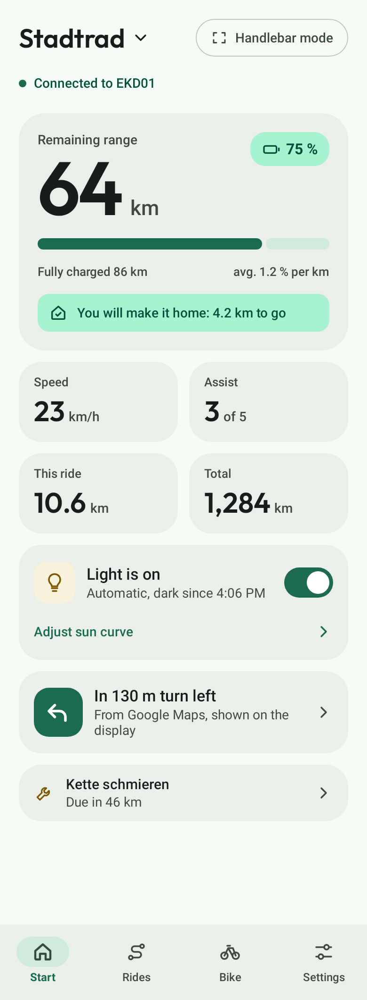
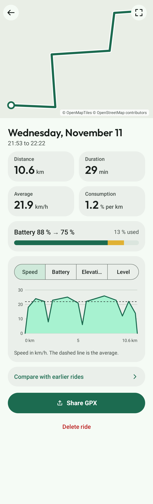
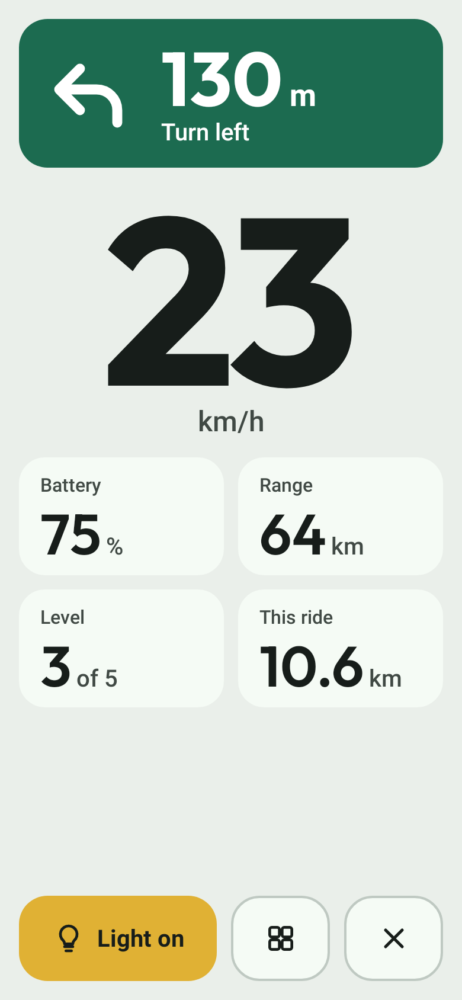
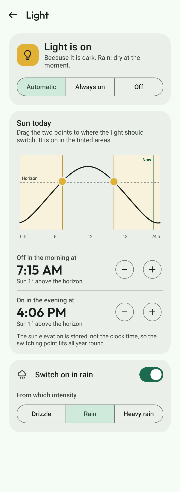

# Robo Bike

An unofficial Android companion app for e-bikes with an **EKD01** display, as used on some Bafang drive systems.
It talks to the display over Bluetooth LE, needs no account and sends nothing to a cloud.

<p>




</p>

## Features

- **Live data**: speed, battery, assist level, trip and odometer.
- **Range**: learned from your own rides per assist level; warns when the battery gets tight for the way home.
- **Light**: automatic headlight by sun elevation (adjustable) and optionally rain; switch it from the app, the
  home-screen widget, a quick-settings tile or the notification.
- **Turn hints on the display**: the arrow and distance from Google Maps' navigation notification appear on the
  bike's display.
- **Rides**: ride log with optional GPS track, speed/battery/elevation charts, statistics, recurring routes,
  heatmap and GPX export.
- **Handlebar mode** for a phone mount, maintenance reminders, drive error codes with explanations.
- Several bikes, km or miles, English and German, backup and restore.
- Connects by itself when the display switches on (Android companion device pairing).

Requires Android 12 or newer and a display that advertises as `EKD01…`.

## Install

- **GitHub Releases**: download the APK from the [releases page](https://github.com/DonRobo/robo-bike/releases).
- **IzzyOnDroid** and **F-Droid**: planned; links follow once the app is listed.

There is no Google Play version.

## Build

```
./gradlew :app:assembleDebug        # debug APK: app/build/outputs/apk/debug/
./gradlew :app:testDebugUnitTest    # unit and screenshot tests (JVM only, no device)
./gradlew :app:assembleRelease      # unsigned release APK, unless signing is configured
```

JDK 17+ and the Android SDK (`local.properties` with `sdk.dir=...`, or `ANDROID_HOME`). Conventions, architecture,
the simulated bike for emulators, and the release process: [docs/DEVELOPMENT.md](docs/DEVELOPMENT.md). The
display protocol: [docs/PROTOCOL.md](docs/PROTOCOL.md).

## Safety

This software comes with **no warranty**. The app only uses the display commands documented in
[docs/PROTOCOL.md](docs/PROTOCOL.md): reading values, switching the headlight, setting the clock and sending
navigation hints. It never changes speed limits, wheel size or motor parameters and never sends firmware
commands. Do not operate the app while riding in a way that distracts you from traffic. Use at your own risk.

## Privacy

All data (rides, positions, settings) stays on your phone; backups are files you export yourself. There are no
accounts, analytics or ads. The app contacts only:

- **Open-Meteo** (`api.open-meteo.com`) for the current weather at a rounded position (about 1 km), only with
  location access granted: while the rain rule of the automatic light is on, and once at the start and once at the
  end of each ride, for the outdoor temperature kept with the ride;
- **OpenFreeMap** (`tiles.openfreemap.org`) for map tiles when a map is shown.

Location and notification access are optional and explained in the app before Android asks for them.

## Trademarks

Robo Bike is not affiliated with or endorsed by Bafang or the display's manufacturer. Product names are used only
to describe compatibility.

## License

Copyright (C) 2026 Robert Tieber

Licensed under the **GNU General Public License v3.0 or later** (`SPDX-License-Identifier: GPL-3.0-or-later`).
This program is free software: you can redistribute it and/or modify it under the terms of the GNU General Public
License as published by the Free Software Foundation, either version 3 of the License, or (at your option) any later
version. It is distributed in the hope that it will be useful, but WITHOUT ANY WARRANTY; without even the implied
warranty of MERCHANTABILITY or FITNESS FOR A PARTICULAR PURPOSE. See [LICENSE](LICENSE) for the full text.

Bundled third-party material: the Outfit font (SIL Open Font License, `app/src/main/assets/licenses/Outfit-OFL.txt`);
libraries under their own licenses (Apache 2.0, MIT, BSD), see `./gradlew :app:dependencies`.

## How this was made

Largely developed with Claude Code (Anthropic); protocol from the author's own analysis; requirements, design and
testing on a real bike by the author.
